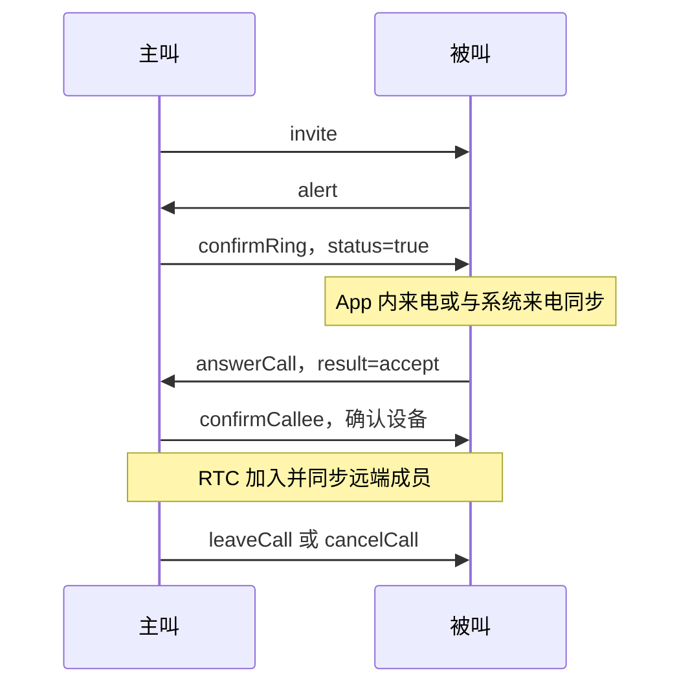

# 音视频通话信令

本项目通过环信 IM 消息的 ext 传递呼叫控制信息，RTC 负责媒体传输。VoIP Push 与普通 APNs 提供离线来电入口，邀请有效性、接听和结束由信令与设备状态确认。 [来电推送](IncomingCalls.md) · [实现源码](../Sources/EaseCallUIKit/Classes/CoreService/Implements/CallKitManager+Signaling.swift)

## 字段与动作

每次通话用唯一的 `callId` 关联，`msgType` 为 `rtcCallWithAgora`。主被叫设备通过 `callerDevId` 和 `calleeDevId` 区分。以下为常量对应的实际 action 字符串。

| 常量 | action | 用途 |
| --- | --- | --- |
| `CALL_INVITE` | `invite` | 主叫发送邀请，包含频道、类型、主叫设备和时间戳 |
| `CALL_ALERT` | `alert` | 被叫通知主叫已收到邀请 |
| `CALL_CONFIRM_RING` | `confirmRing` | 主叫确认邀请是否仍有效，status 为 Boolean |
| `CALL_ANSWER` | `answerCall` | 被叫回复 result，取 accept、refuse 或 busy |
| `CALL_CONFIRM_CALLEE` | `confirmCallee` | 主叫确认响应的被叫设备和结果 |
| `CALL_CANCEL` | `cancelCall` | 主叫取消邀请 |
| `CALL_END` | `leaveCall` | 成员结束或离开通话 |

邀请是普通文本消息，支持离线存储和推送。其他动作使用 CMD 消息，关键确认和取消可离线同步。群组邀请是定向群消息，`receiverList` 限定被邀请成员。

## 邀请内容

```json
{
  "msgType": "rtcCallWithAgora",
  "action": "invite",
  "callId": "unique-call-id",
  "callerDevId": "caller-device-id",
  "channelName": "rtc-channel",
  "type": 0,
  "ts": 1794960000000,
  "call_duration": 0,
  "call_end_reason": 7,
  "callerNickname": "Caller"
}
```

`type` 为 CallType 原始值，0 为 singleAudio，1 为 singleVideo，2 为 groupCall。`ts` 为发送时的毫秒时间戳，业务扩展放在 `ext` 中。群组信息放在 `callkitGroupInfo`，包含 `groupId`、`groupName` 与 `groupAvatar`。邀请初始记录的结束原因为 remoteNoResponse，随后由实际通话结果更新。

邀请按 `enableVOIP` 添加推送扩展。开启时设置 `em_push_ext.type = "call"` 与完整 custom，关闭时通过 `em_apns_ext.extern` 携带普通来电定位信息。

## 单聊流程



普通通知点击只记录待恢复的通话 ID，IM 恢复邀请和主叫确认后才展示 App 内来电。VoIP 必须及时上报系统来电，SDK 将后续系统接听与对应的 IM 邀请关联。重复 payload 通过通话 ID 和当前状态处理。

## 群组与多设备

群呼叫使用一个 callId 和频道，主叫向已选成员发送定向邀请，每个成员独立确认接听或拒接。当前群通话中追加邀请沿用通话与频道，按新增成员建立等待状态。

多设备同时收到同一被叫邀请时，信令携带设备 ID。主叫确认接听设备后，其他设备按对应结果结束来电，上报 handleOnOtherDevice。退出或过期邀请由当前状态和已结束邀请记录处理。

## 超时与结束

主叫等待、被叫振铃和群成员等待使用 `config.ringTimeOut`，默认 30 秒。邀请回复和建立连接确认的部分内部等待使用 `updateDuration`，当前为 5 秒。实际分支以源码中的 timerIdentify 和通话状态判断为准。

取消、拒接、超时、其他设备处理和异常结束统一转换为 CallEndReason，并通过 `didUpdateCallEndReason(reason:info:)` 通知宿主。收到消息时还会核对通话 ID、设备 ID 与当前状态。 [结束原因](APIOverView.md#通话结束原因) · [日志排查](ErrorHandler.md)
